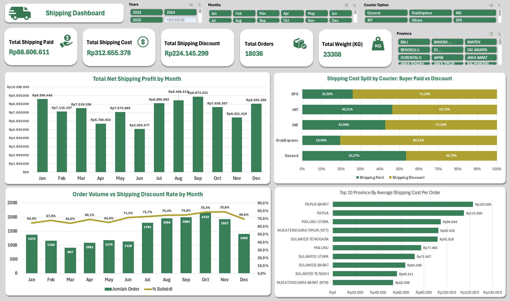
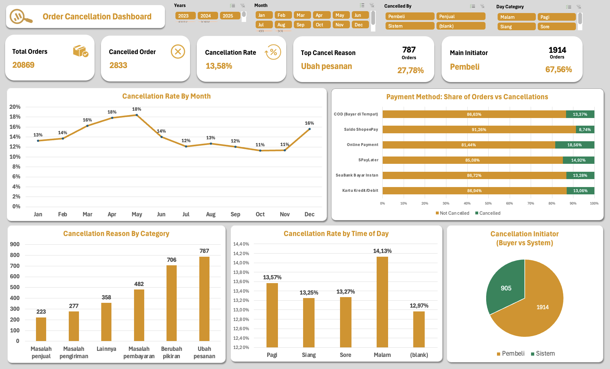
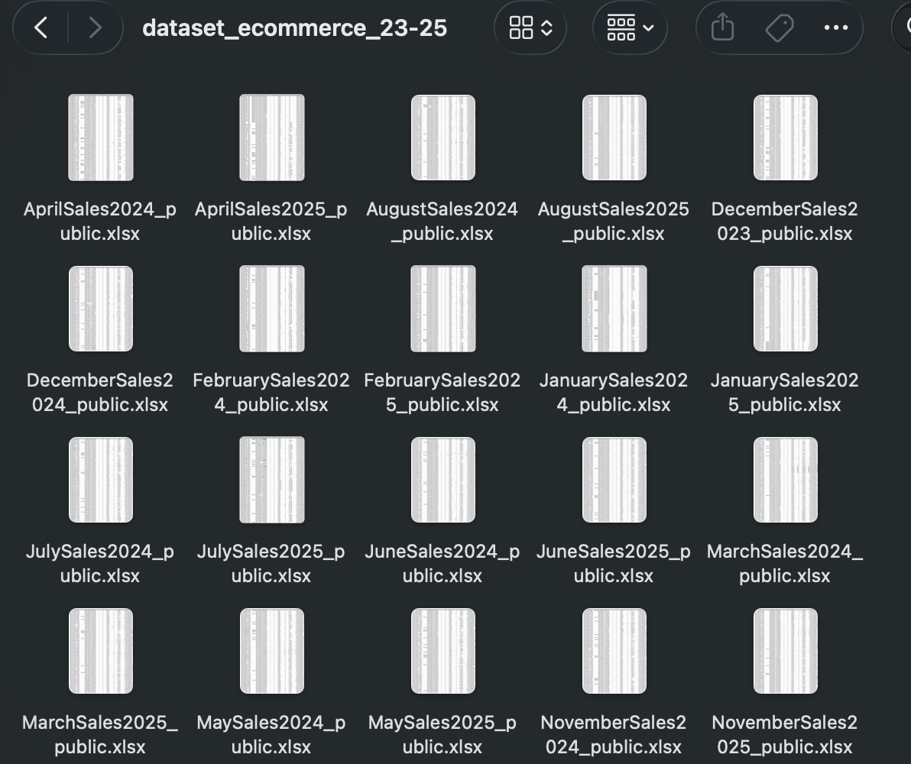
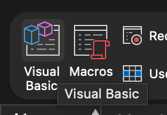
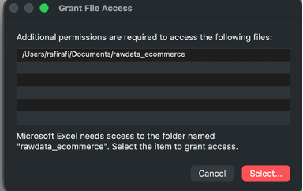
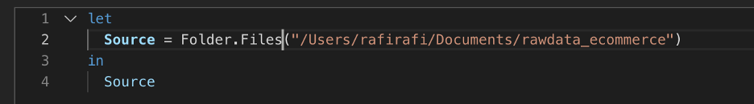
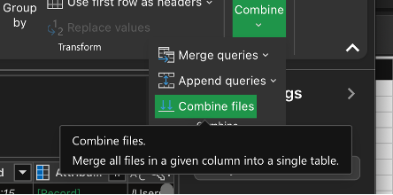
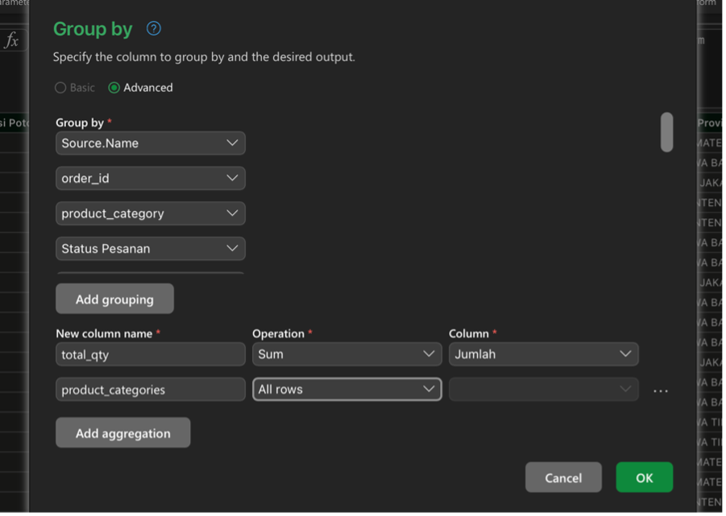
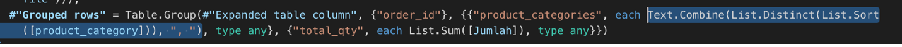
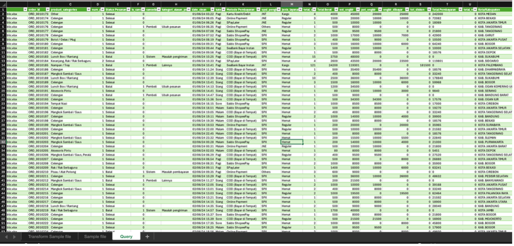

# ecommerce-shipping-cancellation-dashboard-excel

Excel dashboards analyzing shipping cost and order cancellation from 20K+ e-commerce orders (2023-2025)





**E-commerce Shipping and Order Cancellation Analysis (Excel)**

This project analyzes `dataset_ecommerce_23-25` from Kaggle. The dataset comes as monthly Excel files (24 files in total). I merged all of them into one table of about 22K rows, cleaned it, and built 2 dashboards in Excel:

1. Shipping Dashboard
2. Order Cancellation Dashboard

Tool: Microsoft Excel for Mac (Power Query + Dashboard)

**Steps**

Ask - Prepare - Process - Analyze - Share - Act

---

**1. Ask (Define the business questions)**

Since we see there are shipping columns and cancellation columns in the data, I make questions about those 2 aspects.

**Shipping**

1. How much is the total shipping cost, and who pays for it?
2. What is the trend of net shipping profit each month?
3. Does more orders mean more shipping discount?
4. Which courier depends on discount the most?
5. Which province has the most expensive shipping per order?

**Cancellation**

1. How big is the cancellation problem?
2. Is there a pattern by month?
3. Which payment method has the highest cancellation rate?
4. What is the main reason for cancellation?
5. Does the time of day affect cancellation?
6. Who starts the cancellation the most?

---

**2. Prepare (Understand and get the data)**



- Download the raw folder. It has 24 xlsx files, all with the same format.
- Open Excel, go to Data > Get Data > Blank Query.
- Excel for Mac cannot open a folder directly, so I made the folder path first:
  - Go to Developer > Visual Basic and write the path there.
  - Check the result in the Immediate window.
  - Grant access to the folder when Excel asks.





- Go back to the blank query and type this (use your own path):

```
Folder.Files("your folder path here")
```





- Because all 24 files have the same format, click Combine > Combine Files, check the sheet, and continue.
- Check missing values (null) and data types.

---

**3. Process (Clean and transform the data)**

**Fix duplicate order ID**

Some order IDs are duplicated because each row has a different product category, and quantity is split too. Fix: group by order ID, join all category text, and sum the quantity. So 1 row = 1 order.





**Change formats**

- Order created time: change to date/time.
- Total weight: remove "gr", change to whole number.
- Estimated shipping cost and shipping discount: the numbers are mixed (tens, hundreds, thousands). If the value is less than 1000, multiply by 1000. Then change to whole number.
- Total payment: remove the dot, change to whole number (all values are already in thousands).

**Shipping paid**

Shipping paid = estimated shipping cost - shipping discount. If the order is cancelled, it is 0 because the buyer does not pay shipping.

```
if [Status Pesanan] = "Batal" then 0
else Number.Max({0,[est_ongkir] - [pot_ongkir]})
```

**Cancelled dummy column**

1 = cancelled, 0 = not cancelled.

```
if [Status Pesanan] = "Batal" then 1 else 0
```

**Fix empty months**

December 2024 and July 2025 have no order date. So I use the file name to fill the date. This way the trend chart has no empty month.

```
if [Tanggal Pesanan] <> null then [Tanggal Pesanan]
else if [Source.Name] = "DecemberSales2024_public.xlsx" then #datetime(2024, 12, 1, 0, 0, 0)
else if [Source.Name] = "JulySales2025_public.xlsx" then #datetime(2025, 7, 1, 0, 0, 0)
else [Waktu Pesanan Dibuat]
```

**Time category**

I want to analyze time of day, so I add a column from the clean date. Those 2 months with no time are set to null.

```
if [Source.Name] = "DecemberSales2024_public.xlsx" or [Source.Name] = "JulySales2025_public.xlsx" then null
else let h = Time.Hour(DateTime.Time([date_clean])) in
  if h < 3 then "Malam"
  else if h < 11 then "Pagi"
  else if h < 15 then "Siang"
  else if h < 18 then "Sore"
  else "Malam"
```

**Courier**

There are 5 couriers, the rest is "Others".

```
let t = Text.Lower([Opsi Pengiriman]) in
if Text.Contains(t, "spx") then "SPX"
else if Text.Contains(t, "jne") then "JNE"
else if Text.Contains(t, "jnt") or Text.Contains(t, "j&t") then "JNT"
else if Text.Contains(t, "gosend") then "Gosend"
else if Text.Contains(t, "grab") then "GrabExpress"
else "Others"
```

**Shipping type**

I group the shipping options into simple types.

```
let t = Text.Lower([Opsi Pengiriman]) in
if Text.Contains(t, "instan") then "Instant"
else if Text.Contains(t, "same") then "Same Day"
else if Text.Contains(t, "next") then "Next Day"
else if Text.Contains(t, "hemat") or Text.Contains(t, "economy") then "Hemat"
else if Text.Contains(t, "kargo") or Text.Contains(t, "cargo") or Text.Contains(t, "trucking") then "Kargo"
else if Text.Contains(t, "reguler") or Text.Contains(t, "regular") or Text.Contains(t, "standard") or Text.Contains(t, "express") then "Reguler"
else "Others"
```

**Cancelled by**

I group the cancel reason to see who starts the cancellation.

```
let t = Text.Lower([Alasan Pembatalan] ?? "") in
if t = "" then null
else if Text.Contains(t, "pembeli") then "Pembeli"
else if Text.Contains(t, "penjual") then "Penjual"
else if Text.Contains(t, "sistem") then "Sistem"
else "Others"
```

**Reason category**

I group the cancel reason into 6 categories to see customer behavior.

```
let t = Text.Lower([Alasan Pembatalan] ?? "") in
if t = "" then null
else if Text.Contains(t, "alamat") or Text.Contains(t, "voucher") or Text.Contains(t, "mengubah pesanan") or Text.Contains(t, "ubah pesanan") then "Ubah pesanan"
else if Text.Contains(t, "berubah pikiran") or Text.Contains(t, "tidak ingin membeli") or Text.Contains(t, "lebih murah") then "Berubah pikiran"
else if Text.Contains(t, "pembayaran") or Text.Contains(t, "belum dibayar") then "Masalah pembayaran"
else if Text.Contains(t, "produk habis") or Text.Contains(t, "tidak responsif") or Text.Contains(t, "penjual gagal") or Text.Contains(t, "tidak mengatur pengiriman") then "Masalah penjual"
else if Text.Contains(t, "pengiriman gagal") or Text.Contains(t, "paket hilang") then "Masalah pengiriman"
else "Lainnya"
```

**Finish**

Remove the columns that are already cleaned, then reorder the columns.



Result: 20,869 unique orders (2,833 cancelled, 18,036 not cancelled).

---

**4. Analyze (Explore and analyze)**

I used pivot tables to answer the questions in step 1.

Shipping
- Total shipping cost, shipping paid, and shipping discount.
- Net shipping profit by month.
- Order volume vs discount rate by month.
- Paid vs discount share by courier.
- Average shipping cost per order by province (top 10).

Cancellation
- Total orders, cancelled orders, and cancellation rate.
- Cancellation rate by month.
- Orders vs cancellations by payment method.
- Cancellation reason by category.
- Cancellation rate by time of day.
- Cancellation initiator (buyer vs system).

---

**5. Share and Act (Visualization, insight, and action)**

**Shipping Dashboard**


1. How much is the total shipping cost, and who pays for it?

   What we got: Total shipping cost is Rp312,66 million. Buyers paid Rp88,61 million and the discount is Rp224,15 million. So about 72% of shipping cost is paid by discount.

2. What is the trend of net shipping profit each month?

   What we got: Net shipping profit is highest in Sep (Rp8,87 million), Jan (Rp8,60 million), and Aug (Rp8,45 million). It is lowest in Jun (Rp5,08 million) and Apr (Rp5,70 million). The pattern follows the number of orders.

3. Does more orders mean more shipping discount?

   What we got: Yes, more orders usually means more discount. The discount rate is around 64% in Jan, Mar, and May, then goes up to around 78% in Oct and Nov when orders reach 2,152 (Oct). In Dec orders drop to 1,402 and the discount rate drops to 69,6%.

4. Which courier depends on discount the most?

   What we got: GrabExpress depends on discount the most (80,51%), then SPX (74,13%). Gosend is the lowest (46,73%). JNT is 53,75% and JNE is 57,32%.

5. Which province has the most expensive shipping per order?

   What we got: Eastern Indonesia is the most expensive. Papua Barat is Rp123.000, Papua is Rp115.000, then Maluku Utara (Rp94.644), NTT (Rp92.533), and Sulawesi Tenggara (Rp91.816).

Other insight:
- The discount rate is above 64% in every month, so the platform always pays most of the shipping cost.
- Gosend is the only courier where buyers pay more than half of the shipping cost (53,27%).
- The whole top 10 expensive provinces are in eastern and central Indonesia.

Action:
- Review the cooperation with GrabExpress and SPX because their discount share is the highest.
- Set a discount limit or a special rate for Papua and Maluku.
- Control the discount in peak months (Oct-Nov) so it does not hurt the margin too much.

**Order Cancellation Dashboard**


1. How big is the cancellation problem?

   What we got: From 20.869 orders, 2.833 are cancelled. The cancellation rate is 13,58%, around 1 in 7 orders.

2. Is there a pattern by month?

   What we got: The rate goes up from 13% in Jan to the peak of 18% in Apr-May. It goes down to 11% in Oct-Nov, then goes up again to 16% in Dec.

3. Which payment method has the highest cancellation rate?

   What we got: Online Payment is the highest (18,56%), then SPayLater (14,92%). Saldo ShopeePay is the lowest (8,74%). Others are around 13%.

4. What is the main reason for cancellation?

   What we got: The top reasons are Ubah pesanan (787) and Berubah pikiran (706). They are much higher than Masalah pembayaran (482), Masalah pengiriman (277), and Masalah penjual (223).

5. Does the time of day affect cancellation?

   What we got: Malam is the highest (14,13%). Siang (13,25%) and Sore (13,27%) are the lowest. The difference is only about 1 point, so time of day is not a big factor.

6. Who starts the cancellation the most?

   What we got: Buyer starts 1.914 cancellations (67,56%) and system starts 905 (about 32%).

Other insight:
- Most cancellations come from buyer behavior (changing the order or changing their mind), not from seller or delivery problems.
- Oct-Nov have many orders but the lowest cancellation rate, so busy months are not the risky months.
- System cancellations are still about 1 in 3, which may be related to payment problems.

Action:
- Let buyers edit the order (address, voucher, variation) without cancelling.
- Improve the Online Payment flow, for example payment reminders and retry payment.
- Prepare customer service and retention promos for Apr-May and Dec.
